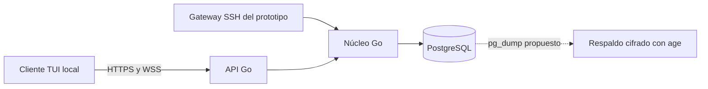

# Arquitectura de Karatty

Estado: prototipo previo a la alpha pública. Este documento describe el código actual. El diseño de E2EE aún está pendiente; ningún mensaje actual puede considerarse cifrado de extremo a extremo.

## Vista general

El proceso `cmd/server` ofrece la API y, opcionalmente, el gateway SSH. `cmd/ssh-gateway` permite ejecutar el gateway por separado. `cmd/termlink` compila el cliente `karatty`. El cliente local usa `pkg/client` para HTTPS y WebSocket; `pkg/tui` contiene la interfaz Bubble Tea. La TUI SSH se ejecuta en el servidor y comparte el núcleo, por eso queda fuera de la alpha con E2EE.

## Tecnologías actuales

| Componente | Tecnología y motivo |
| --- | --- |
| Cliente y servidor | Go 1.27.3; un módulo compartido y compilación nativa para Windows, Linux y macOS. |
| Interfaz terminal | Bubble Tea v2 y Bubbles v2 para la TUI local. |
| Gateway de prototipo | Wish v2 sobre SSH; permite una TUI remota, pero su proceso ve el contenido en claro. |
| API y eventos | JSON sobre HTTPS y WebSocket seguro; sesiones Bearer de duración limitada. |
| Persistencia | PostgreSQL 17.11 con pgx; transacciones para secuencia, membresía y reintentos. |
| Respaldos propuestos | `pg_dump`, `age` y `rclone`; el almacenamiento remoto aún no está contratado ni ensayado. |

Las versiones de dependencias de Go están fijadas en `go.mod` y `go.sum`; consulta [fuentes y versiones](dependencies.md). El [ADR 0003](adr/0003-e2ee-1to1.md) elige Olm con secreto futuro y la biblioteca Rust vodozemac para la alpha. `crypto/` contiene una prueba aislada de intercambio; aún no se integra con el cliente ni verifica E2EE extremo a extremo.

| Paquete | Responsabilidad actual |
| --- | --- |
| `internal/auth` | Registro, prueba de posesión de la clave, sesiones, recuperación y eliminación de cuenta. |
| `internal/chat` | Solicitudes y aceptación de directos, membresías, mensajes, historial y bloqueo. |
| `internal/transport` | Rutas HTTP/WSS, gateway SSH, límites de transporte y configuración TLS. |
| `internal/storage` y `migrations` | Conexión PostgreSQL, migraciones y purga de datos vencidos. |
| `internal/security` | Validación de entradas, identificadores aleatorios, hashes y límites de tasa. |
| `pkg/protocol` | Tipos JSON compartidos entre servidor y cliente. |

## Identidad y acceso

El registro de ensayo abierto recibe un seudónimo y una clave pública Ed25519. El cliente firma un desafío de dos minutos y un solo uso con su clave privada. El servidor guarda la clave pública, emite una sesión temporal y entrega un código de recuperación de 192 bits una sola vez; solo conserva su hash. El inicio de sesión repite la prueba de posesión. La recuperación exige el código y una firma con la clave nueva, revoca claves y sesiones anteriores y rota el código. También existe un modo de invitaciones para las pruebas del prototipo.

Cada operación comprueba la sesión, la clave, el usuario y, cuando corresponde, la membresía. Para abrir un directo, una persona solicita conversar y la destinataria debe aceptar con una solicitud recíproca. Los bloqueos impiden nuevos mensajes y solicitudes. En el modo `--public-signup`, el proceso del servidor solo escucha en loopback, no inicia la TUI SSH y rechaza los canales. Este bloqueo seguirá hasta que E2EE esté implementado y probado.

## Mensajes y tiempo real

PostgreSQL asigna la secuencia de cada conversación dentro de la transacción que inserta el mensaje. `client_id` permite reintentos idempotentes durante la retención; reutilizarlo con otro cuerpo produce conflicto. El ACK confirma persistencia, no lectura por la otra persona. El historial se pagina de 100 en 100 y el cliente puede reconectar desde la última secuencia recibida. WebSocket consulta el registro durable aproximadamente cada 250 ms y vuelve a verificar autorización en cada lote. No hay Redis ni cola de mensajes separada.

La base **guarda actualmente el cuerpo en claro**. HTTPS/WSS protege el transporte, y los respaldos se cifran antes de salir del VPS, pero eso no impide que el servidor lea los mensajes. Antes de la alpha pública, el cliente tendrá que cifrar y descifrar localmente, verificar la identidad del interlocutor y enviar solo sobres cifrados. La API y el esquema deberán impedir cuerpos en claro. La recuperación de cuenta no deberá prometer recuperar mensajes anteriores si se pierde la clave de descifrado. El protocolo concreto y sus garantías se documentarán cuando exista una implementación probada.

## Retención y operación

El historial oculta mensajes con más de 720 horas. La purga por lotes borra cuerpos e identificadores vencidos; en el modo de ensayo abierto se ejecuta al arrancar y cada hora. La deduplicación queda garantizada solo durante esos 30 días. El plan de despliegue usa PostgreSQL en un VPS pequeño y `pg_dump` cifrado con `age` hacia un bucket privado. La restauración se ha ensayado localmente, pero la copia y el vencimiento remotos siguen pendientes de prueba operativa. Consulta [operación](operations.md) y [seguridad](security.md).

## Límites de la primera alpha

La alpha tendrá cliente TUI instalable y chats directos 1:1 con aceptación. El registro será seudónimo y sin correo. Los canales, la TUI remota por SSH, varios dispositivos, adjuntos, búsqueda y notificaciones quedan fuera del alcance inicial. El [roadmap](roadmap.md) registra lo que se investigará después; no es una promesa de fecha.
