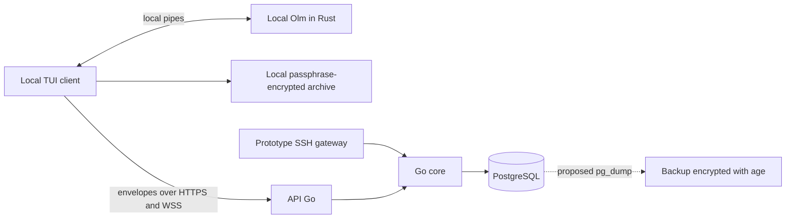

# Karatty architecture

**English** · [Español](es/architecture.md) · [Italiano](it/architecture.md)

Experimental alpha for local use; two-machine LAN testing is pending. The project does not operate a hosted service. Open registration uses local E2EE for direct chats; the older invitation/remote-SSH prototype does not.

## Overview

`cmd/server` provides the API and an optional prototype SSH gateway. `cmd/ssh-gateway` runs that gateway separately. `cmd/termlink` builds the `karatty` client. HTTPS/WSS live in `pkg/client`; `pkg/tui` holds the Bubble Tea interface. A remote SSH TUI executes on the server and shares its core, so it is excluded from the E2EE alpha.

The canonical module is `github.com/karatekah/karatty`. Historical v0.1.0-alpha.1 source uses the former `termlink` module path. Existing `cmd/termlink` build paths, `TERMLINK_*` variables and legacy authentication domains retain their spelling for compatibility.

## Stack and packages

| Component | Technology and reason |
| --- | --- |
| Client/server | Go 1.27.3; one shared module, native Windows/Linux/macOS builds |
| Terminal UI | Bubble Tea v2 and Bubbles v2 |
| Prototype gateway | Wish v2 over SSH; its process sees readable content |
| API/events | JSON over HTTPS/WSS and short-lived Bearer sessions |
| Storage | PostgreSQL 17.11 and pgx; transactional sequences, membership and retries |
| Planned backups | `pg_dump`, `age`, `rclone`; remote storage has not been purchased or tested |

Go versions are pinned in `go.mod`/`go.sum`; see [dependencies](dependencies.md). [ADR 0003](adr/0003-e2ee-1to1.md) selects Olm and Rust vodozemac. `crypto/` performs local Olm operations; `pkg/secureclient` verifies identities, persists ratchets and adapts messages for the TUI; `pkg/localstate` encrypts state with Argon2id and XChaCha20-Poly1305. Integration tests exchange real messages and check opaque database envelopes.

| Package | Responsibility |
| --- | --- |
| `internal/auth` | Registration, key-possession proof, sessions, recovery, account deletion |
| `internal/chat` | Direct requests/acceptance, membership, messages, history, blocking |
| `internal/e2ee` | Public identities and one-time keys, restricted to accepted direct-chat members |
| `internal/transport` | HTTP/WSS routes, prototype SSH, transport limits and TLS configuration |
| `internal/storage`, `migrations` | PostgreSQL connection, migrations and expired-data purging |
| `internal/security` | Input validation, random identifiers, hashes and rate limits |
| `pkg/protocol` | Shared JSON contracts |

## Identity and access

Open registration takes a pseudonym and Ed25519 public key. The client signs a random, single-use, two-minute challenge. The server stores the public key, issues a temporary session and shows a 192-bit recovery code once; it stores only the code's hash. Login repeats possession proof. Recovery requires that code and a signature from the new SSH key, revokes previous keys/sessions and rotates the code. Invitation mode remains for prototype tests.

Each operation checks session, key, account and applicable membership. Direct chats require a reciprocal request from the recipient; blocks prevent messages and requests. `--public-signup` rejects channels and a remote SSH TUI, and defaults to loopback. `--public-network` permits non-loopback LAN/Internet listeners only with TLS and this encrypted mode. The [local/LAN guide](quickstart.md) creates IP-SAN certificates. The [future deployment procedure](deploy.md) has not been executed on a VPS.

## Messages and real time

PostgreSQL assigns each conversation's sequence inside the message-insert transaction. `client_id` supports idempotent retries during retention; reusing it with different content conflicts. ACK means persistence, not reading. History pages contain up to 100 messages. WSS reads the durable log roughly every 250 ms and rechecks authorization on each batch. No Redis or separate queue is needed.

The invitation prototype (`--legacy`) stores readable bodies. In `--public-signup`, the official client encrypts locally and the API stores an opaque envelope. The server validates structure/limits but cannot prove a modified client encrypted correctly. The TUI requires out-of-band contact verification before sending or decrypting.

A local passphrase protects history and ratchet state. Losing it prevents archive access. SSH-key recovery creates a new Olm identity and starts at the current server sequence; the contact must verify the new fingerprint. With the previous local passphrase, the client migrates already-readable history, saves the new device and removes the old state. Unacknowledged older sends become uncertain and are not automatically replayed. Recovery cannot decrypt older messages absent from the local archive.

## Retention and operations

History hides messages older than 720 hours. Startup/hourly purging in open-registration mode removes expired bodies and identifiers, so deduplication lasts only 30 days. The future hosting plan uses a small VPS and `pg_dump` encrypted with `age` into a private bucket. Restoration has been tested locally; remote backup/expiry still need provider tests. See [operations](operations.md) and [security](security.md).

## Alpha scope

Installed local TUI, accepted 1:1 chats, pseudonymous registration without email and one device per account. Channels, remote SSH TUI, multiple devices, attachments, search and notifications are outside this release. The [roadmap](roadmap.md) records future investigation without a promised date.
