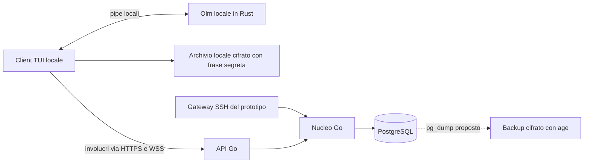

# Architettura di Karatty

[English](../architecture.md) · [Español](../es/architecture.md) · **Italiano**

Alpha sperimentale per uso locale; manca la prova LAN fra due macchine fisiche. Il progetto non offre un servizio ospitato. La registrazione aperta usa E2EE locale per le chat dirette; il vecchio prototipo a inviti/SSH remoto no.

## Vista generale

`cmd/server` espone API e gateway SSH opzionale del prototipo. `cmd/ssh-gateway` avvia il gateway separatamente. `cmd/termlink` compila il client `karatty`. `pkg/client` gestisce HTTPS/WSS, `pkg/tui` l'interfaccia Bubble Tea. La TUI SSH gira sul server e condivide il suo nucleo, quindi è esclusa dall'alpha E2EE.

Il modulo canonico è `github.com/karatekah/karatty`. Il sorgente storico v0.1.0-alpha.1 mantiene `termlink`. Per compatibilità, percorsi `cmd/termlink`, variabili `TERMLINK_*` e domini di autenticazione preesistenti conservano la grafia.

## Tecnologie e pacchetti

| Componente | Tecnologia e motivazione |
| --- | --- |
| Client/server | Go 1.27.4; modulo condiviso, build native Windows/Linux/macOS |
| Terminale | Bubble Tea v2 e Bubbles v2 |
| Gateway del prototipo | Wish v2 su SSH; il processo vede contenuti leggibili |
| API/eventi | JSON su HTTPS/WSS, sessioni Bearer temporanee |
| Persistenza | PostgreSQL 17.11 e pgx; transazioni per sequenze, appartenenza e ritentativi |
| Backup previsti | `pg_dump`, `age`, `rclone`; archivio remoto non acquistato né provato |

Le versioni Go sono fissate in `go.mod`/`go.sum`; vedi [dipendenze](dependencies.md). [ADR 0003](adr/0003-e2ee-1to1.md) sceglie Olm e Rust vodozemac. `crypto/` esegue Olm localmente; `pkg/secureclient` verifica identità, persiste ratchet e adatta messaggi alla TUI; `pkg/localstate` cifra lo stato con Argon2id/XChaCha20-Poly1305. Le integrazioni scambiano messaggi reali e controllano involucri opachi nella base.

| Pacchetto | Responsabilità |
| --- | --- |
| `internal/auth` | Registrazione, possesso della chiave, sessioni, recupero, eliminazione |
| `internal/chat` | Richieste/accettazione, appartenenza, messaggi, cronologia, blocco |
| `internal/e2ee` | Identità pubbliche e chiavi monouso, solo fra membri di chat accettate |
| `internal/transport` | HTTP/WSS, SSH del prototipo, limiti e TLS |
| `internal/storage`, `migrations` | PostgreSQL, migrazioni e pulizia delle scadenze |
| `internal/security` | Validazione, identificatori casuali, hash e limiti di frequenza |
| `pkg/protocol` | Contratti JSON condivisi |

## Identità e accesso

La registrazione riceve pseudonimo e chiave pubblica Ed25519. Il client firma una sfida casuale monouso di due minuti. Il server salva la chiave pubblica, emette una sessione temporanea e mostra una volta un codice di recupero di 192 bit, conservandone solo l'hash. Il login ripete la prova di possesso. Il recupero richiede codice e firma della nuova chiave, revoca chiavi/sessioni precedenti e ruota il codice. Gli inviti rimangono per test del prototipo.

Ogni operazione controlla sessione, chiave, account e appartenenza richiesta. Il destinatario deve inviare una richiesta reciproca per aprire il diretto; il blocco impedisce richieste/messaggi. `--public-signup` esclude canali/TUI SSH remota e usa loopback per impostazione predefinita. `--public-network` consente ascolto LAN/Internet fuori loopback solo con TLS e modalità cifrata. La [guida](quickstart.md) genera certificati con SAN IP; il [piano VPS](deploy.md) non è stato eseguito.

## Messaggi e tempo reale

PostgreSQL assegna la sequenza della conversazione nella transazione d'inserimento. `client_id` consente ritentativi idempotenti durante la conservazione; riutilizzarlo con altro contenuto genera conflitto. ACK significa persistenza, non lettura. La cronologia usa pagine di 100. WSS legge il registro durevole circa ogni 250 ms, rivalutando l'autorizzazione per lotto. Non serve Redis o una coda separata.

Il prototipo a inviti (`--legacy`) salva corpi leggibili. Con `--public-signup`, il client ufficiale cifra localmente e l'API memorizza involucri opachi. Il server verifica struttura/limiti, ma non dimostra che un client modificato abbia cifrato correttamente. La TUI esige verifica indipendente delle impronte prima d'inviare o decifrare.

La frase locale protegge cronologia e ratchet; perderla impedisce l'accesso. Recuperare la chiave SSH crea una nuova identità Olm e parte dalla sequenza corrente; il contatto deve verificare la nuova impronta. Con la frase precedente il client migra la cronologia leggibile, salva il nuovo dispositivo ed elimina il vecchio stato. Gli invii senza ACK diventano incerti e non vengono ripetuti automaticamente. Il recupero non decifra messaggi assenti dall'archivio locale.

## Conservazione e operazioni

Dopo 720 ore la cronologia nasconde i messaggi. La pulizia all'avvio/ogni ora elimina corpi e identificatori in modalità aperta; deduplicazione limitata a 30 giorni. Il piano futuro usa VPS e `pg_dump` cifrato con `age` in un bucket privato. Il ripristino è stato provato localmente; copie/scadenze remote richiedono verifiche del provider. Vedi [operazioni](operations.md) e [sicurezza](security.md).

## Ambito dell'alpha

TUI locale installata, diretti 1:1 accettati, pseudonimi senza email e un dispositivo per account. Canali, TUI SSH remota, dispositivi multipli, allegati, ricerca e notifiche sono esclusi. La [roadmap](roadmap.md) descrive ricerche future senza date promesse.
